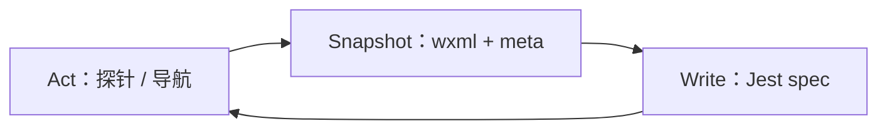

# 小程序脚本编写（miniprogram-script-author）

详见 [conventions.md](../miniprogram-shared/conventions.md)、[selectors.md](../miniprogram-shared/selectors.md)。

**职责**：读用例 → 模拟器 + automator 抓 WXML → 生成 Jest spec → 维护 `suite.json`。**不**对正式模块 `*.spec.js` 执行 Jest 并下 PASS/FAIL 结论（校验请 `@miniprogram-run`）。**不**写批量测试报告（执行与 Session 报告由 `@miniprogram-run` 负责）。

---

## 硬性前置：仓库脚手架

若用户自动化仓库缺少 `scripts/miniprogram-launch.js` 或 `miniprogram/tests/helpers/auth.js`，**先**执行（目标为含/将含 `miniprogram/` 的仓库根）：

```bash
bash <skills-root>/miniprogram-shared/scaffold.sh .
```

并确认：

1. 已复制并填写 `miniprogram.local.config`（见 `miniprogram.local.config.example`）
2. 已安装依赖（见 `miniprogram-shared/templates/package.deps.md`）
3. 已设置 `MP_ACCOUNT` / `MP_PASSWORD`（模板 helper 不写死账号）

然后再进入探索与写 spec。

---

## 交错快照（browser-use 风格）

- **快照** ≈ `element.wxml()` + `page.data()` 落盘 inspect
- **行动** ≈ 探针脚本、`capture-wxml.js`、partial spec、人机协同导航

界面每发生有意义变化，在 CLI 与模拟器可用时采 WXML 落盘 `miniprogram/inspect/run-<RunId>/`，再从 inspect 写 spec。**禁止**未对照快照就写可执行的 `page.$()` / `tap()` / `expect(...)`。



---

## 强制流程（探索优先）

**默认（多 TC）**：对**每一个用例 ID** 串行迷你闭环，**本条完成后再下一条**。

1. **解析用例** → 关键页映射 → 读仓库 inspect → 仅补采本条缺口（探针 / `capture-wxml.js` / 人机协同）。
2. **写 spec**：仅用本条已读或新采 WXML 中的选择器；满足门禁后**立即落盘**（追加到该模块的 `<模块>.spec.js`，不新建一文件一条）。
3. **同步 suite**：更新 `miniprogram/suite.json`（见 conventions；批量执行唯一入口）。
4. **校验**：**不**在本 Skill 内对正式用例跑 Jest。交付时写明 **「待 @miniprogram-run 校验」**。

**允许**的 CLI：`node scripts/capture-wxml.js`、对 **`miniprogram/probes/`** 下探针脚本（仅导航，不含业务断言）。

### 用例输入格式

| 格式 | 处理方式 |
|------|----------|
| Excel (.xlsx) | `node scripts/parse-testcases.js --input cases.xlsx --out cases.json` |
| Markdown / 文本 | Agent 直接解析表格或编号步骤 |
| XMind | 优先引导导出 `.md`；或 Agent 读 `.xmind` 导出内容 |

解析后每条用例须含：`id`、`title`、`order`、`steps`、`expected`（及可选 `precondition`、`data`）。

### 探索优先：从用例到 inspect

1. **用例 → 关键页**（登录页、列表、弹层等），明确 `RunId` 与落盘目录。
2. **仓库先行**：读 `miniprogram/inspect/run-<RunId>/` 及历史 `inspect/run-*`；列出本条缺口。
3. **CLI 采集**（模拟器可用）：

```bash
node scripts/capture-wxml.js \
  --page /pages/login/login \
  --out miniprogram/inspect/run-<RunId>/登录页_<YYYYMMDD-HHmm>.wxml
```

路径从 `<skills-root>/miniprogram-shared/miniprogram.local.config` 读取 `cliPath`、`projectPath`（**禁止臆造**）。

4. **写本条 describe**：步骤须在 WXML / meta.json 中有依据；落盘到 `tests/<模块>/<模块>.spec.js`。

### 按需探索

只采**本条会经过且仓库不能支撑选择器**的页面；不必全应用包网。已有历史 inspect 且仍可用则直接引用。

### 反模式（必遵）

| 规则 | 要求 |
|------|------|
| 一条 TC 一闭环 | 够用即追加 describe → 更新 suite → 下一条 |
| 一模块一文件 | 同模块用例放在同一 `<模块>.spec.js`；禁止再新建 `01_TC-*.spec.js` |
| 禁止并行 automator | 同模拟器禁止同时跑多个 launch / Jest |
| 探针最小化 | 探针仅服务本条缺口页 |
| 会话复用 | 业务用例用 `ensureLoggedIn`；禁止每条强制 `clearStorage` + 完整登录 |
| 够用即停 | 选择器够写 spec 即停探索 |
| 共用片段 | 断言稳定 chrome；数据断言放在用例 describe 内 |

### 探针脚本（probes）

`miniprogram/probes/run-<RunId>/navigate_<页面>.js` — 仅导航，示例：

```javascript
const { launchMiniProgram } = require('../../../scripts/miniprogram-launch');

(async () => {
  const miniProgram = await launchMiniProgram();
  try {
    const page = await miniProgram.reLaunch('/pages/login/login');
    await page.waitFor(500);
    console.log('Reached:', page.path);
  } finally {
    await miniProgram.close();
  }
})();
```

---

## 硬性前置条件

### projectPath / cliPath（必填）

缺失则停止生成，向用户索要。可复制 `miniprogram.local.config.example` → `miniprogram.local.config`。

### inspect 依据

每个关键页须有 WXML 快照或 meta.json。来源优先级：仓库 inspect → 用户粘贴 WXML → 已核对记录。**禁止**仅以 Excel 为唯一依据。

### 探索穷尽阻塞

仅在探索穷尽后仍缺材料时，**不得**落盘可执行 spec。回复含：阻塞原因、缺失清单、用户下一步。勿罗列虚构 spec 路径。

---

## 输入与输出

### 输入

- `projectPath`、`cliPath`（或 `wsEndpoint`）
- 用例 ID、场景简述、`RunId`
- 前置、数据、步骤、预期
- 用例文件（Excel / MD / 文本）

### 输出

- `miniprogram/tests/<模块>/<模块>.spec.js`（一模块一文件；模块如 `auth` / `home` / `maintenance` / `profile`）
  - 文件已存在则**追加**顶层 `describe('<用例ID> <标题>', …)`；不存在则新建
- 共用：`miniprogram/tests/helpers/auth.js`、`helpers/trace.js`
- 更新 `miniprogram/suite.json`
- inspect：`miniprogram/inspect/run-<RunId>/*.wxml` + `.meta.json`

### suite.json 增量维护

每完成一条 TC 的 describe，**随即**在 `suite.json` 的 `cases[]` 中插入或追加：

```json
{
  "order": 1,
  "id": "TC-MP-001",
  "title": "使用手机号+密码登录成功并进入首页",
  "module": "auth",
  "file": "tests/auth/auth.spec.js"
}
```

同模块多条用例的 `file` 均指向同一模块文件。执行顺序仅由 `order` 决定；**无需**重命名 spec 文件。

---

## 生成规则

1. 使用 `scripts/miniprogram-launch.js` 的 `launchMiniProgram()` 启动/连接。
2. 顺序：启动 → `createTrace` →（`ensureLoggedIn`/`forceLogin` 传入 trace）→ `trace.step` 包裹关键操作与断言 → `trace.flush`。
3. **登录**：业务用例用 `ensureLoggedIn`（会话复用）；测登录流用 `forceLogin`；禁止业务用例无条件 `clearStorageSync`。
4. **伪 Trace**：每个 describe **必须**接入 `createTrace` + `trace.step` + `afterAll` 中 `flush`（见 `helpers/trace.js`）。`ensureLoggedIn` / `forceLogin` / 登录页步骤**不截 png**（仍落 meta/wxml）。
5. 选择器：见 [selectors.md](../miniprogram-shared/selectors.md)。
6. 断言与预期一一对应。
7. 自定义组件内须 `element.$()`，禁止 `page.$()` 跨组件。
8. 每个用例独立顶层 `describe`，各自 `beforeAll` / `afterAll` / `createTrace({ caseKey: '<用例ID>' })`；`describe` 名须以用例 ID 开头（供 suite `--testNamePattern` 匹配）。

### Spec 骨架（示意；选择器须来自 inspect）

```javascript
// auth 模块｜登录相关用例
const { launchMiniProgram } = require('../../../scripts/miniprogram-launch');
const { PHONE, PASSWORD, forceLogin } = require('../helpers/auth');
const { createTrace } = require('../helpers/trace');

describe('TC-MP-001 使用手机号+密码登录成功并进入首页', () => {
  let miniProgram;
  let page;
  let trace;

  beforeAll(async () => {
    miniProgram = await launchMiniProgram();
    trace = createTrace(miniProgram, { caseKey: 'TC-MP-001' });
  });

  afterAll(async () => {
    if (trace) await trace.flush();
    await miniProgram.close();
  });

  it('should login with phone and land on home', async () => {
    await trace.step('force_login_phone', async () => {
      page = await forceLogin(miniProgram, PHONE, PASSWORD, trace);
    });
    await trace.step('assert_home_and_token', async () => {
      page = await miniProgram.currentPage();
      expect(String(page.path)).toContain('pages/home/home');
    });
  });
});

describe('TC-MP-002 使用身份证号+密码登录成功并进入首页', () => {
  // 同模块追加；各自 beforeAll / afterAll / createTrace
});
```

### 共用 helper（示意）

- `miniprogram/tests/helpers/auth.js`：`ensureLoggedIn` / `forceLogin` / `findByText` / `mockConfirmModal`
- `miniprogram/tests/helpers/trace.js`：`createTrace`（`step` / `flush` → `trace/viewer.html`；登录相关步骤跳过截图）
---

## 回复格式（生成任务）

**成功生成 spec 时**：

1. **探索摘要**：已读/新增 inspect 路径。
2. **逐 TC**：用例 ID、模块文件路径、describe 名、关键页 ↔ WXML 文件。
3. **suite** 是否已更新及插入位置。
4. **明确**：**未执行正式用例 Jest 回归** — 请 `@miniprogram-run` 校验。

**阻塞时**：仅输出阻塞结构，无虚构路径。

---

## 边界

- 不编造 automator 不支持的 API。
- 不省略用户要求的断言。
- 无 inspect 证据不得声称选择器已验证。
- **禁止**对正式用例宣称 PASS/FAIL（探针导航除外）。
